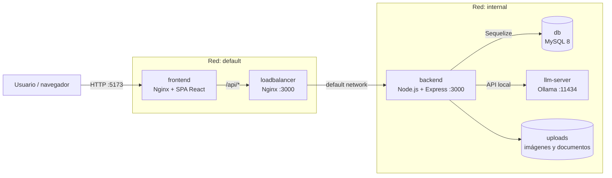

# Arquitectura actual del proyecto

## 1. Resumen

InventarioDocker es una aplicación web para la gestión de activos, ubicaciones,
solicitudes y usuarios, solicitada por Los Libertadores. La solución está organizada como una
arquitectura de tres capas desplegada mediante Docker Compose:

- **Presentación:** aplicación desarrollada con React, TypeScript y Vite.
- **Aplicación:** API REST desarrollada con Node.js y Express.
- **Persistencia:** MySQL administrado mediante Sequelize.

La solución incorpora además un servicio local de inteligencia artificial basado
en Ollama, almacenamiento persistente para la base de datos y el modelo de IA,
y Nginx como servidor web y proxy inverso.

## 2. Vista de despliegue

### Contenedores

| Servicio | Tecnología | Responsabilidad | Exposición |
|---|---|---|---|
| `frontend` | Nginx Alpine | Sirve los archivos compilados de React y reenvía `/api/` al balanceador | `5173:80` |
| `loadbalancer` | Nginx Alpine | Proxy inverso hacia el backend | `3000` |
| `backend` | Node.js 20 + Express | Expone la API, autentica usuarios, aplica permisos y ejecuta la lógica de negocio | Red --internal Docker |
| `db` | MySQL 8 | Persistencia relacional | `3306` |
| `db-init` | Node.js 20 | Inicializa y puebla la base de datos mediante `seed.js` | Sin puerto |
| `llm-server` | Ollama | Ejecuta el modelo local utilizado por el asistente de IA | `11434` |

La red `internal` conecta la base de datos con el backend, el servidor de IA y el proceso de
inicialización sin exposición directa al exterior. La red `default` conecta la
interfaz, el balanceador, el backend. Los volúmenes
`mysql_data` y `ollama_data` conservan los datos entre reinicios.

## 3. Frontend

El frontend se encuentra en [`services/frontend`](../services/frontend) y se
compila con Vite. La entrada [`main.tsx`](../services/frontend/src/main.tsx)
monta React dentro de `BrowserRouter`; [`App.tsx`](../services/frontend/src/App.tsx)
delega el enrutamiento a `AppRouter`.

### Organización principal

- `pages/`: vistas de inicio de sesión, landing, dashboard, activos,
  solicitudes y usuarios.
- `components/layout/`: layout autenticado, barra lateral y navegación.
- `components/common/`: componentes compartidos, incluido el chatbot.
- `components/specific/`: componentes asociados a funcionalidades concretas,
  como el formulario de alta de activos.
- `services/api.ts`: cliente Axios común para las peticiones a la API e
  inyección del token JWT almacenado en `localStorage`.
- `routes/AppRouter.tsx`: rutas públicas y rutas protegidas.

En producción, el despliegue es orquestado por `docker-compose`, el cual utiliza el `Dockerfile` para compilar la aplicación (`npm run build`) y servir el resultado `dist` mediante Nginx. El fallback de Nginx hacia `index.html` permite que funcionen las rutas de la SPA. Las peticiones a la API son gestionadas por el cliente Axios (`services/api.ts`), el cual se comunica con el servicio `loadbalancer`, cuyo puerto 3000 es expuesto externamente a través de la configuración de Docker Compose.

## 4. Backend

El backend se encuentra en [`services/backend`](../services/backend). Su
entrada es [`index.js`](../services/backend/index.js), que carga la
configuración, registra los modelos, sincroniza Sequelize y levanta Express.
La configuración HTTP y el registro de rutas se concentran en
[`app.js`](../services/backend/app.js).

La organización interna sigue una separación por responsabilidades:

- `routes/`: definición de endpoints y composición de middlewares.
- `controllers/`: recepción de solicitudes HTTP y respuestas.
- `services/`: lógica de negocio reutilizable y envío de correos.
- `models/`: modelos Sequelize y relaciones entre entidades.
- `middlewares/`: JWT, autorización por permisos, carga de imágenes y
  documentos, y manejo de errores del LLM.
- `database/connection.js`: conexión Sequelize con MySQL.
- `utils/`: validadores y utilidades auxiliares.

### API principal

Las rutas se publican bajo el prefijo `/api`:

- `/api/accounts`: login, renovación de token, registro, usuarios, roles,
  contraseñas y avatares.
- `/api/establecimientos`: establecimientos educacionales.
- `/api/ubicaciones`: ubicaciones y dependencias.
- `/api/activos`: alta, consulta, ficha, historial y documentos de activos.
- `/api/solicitudes`: creación, consulta y evaluación de solicitudes.
- `/api/roles`: administración de roles y permisos.
- `/api/chat`: consultas al asistente de IA local.

Los archivos subidos se guardan bajo `services/backend/uploads` y se sirven
mediante la ruta estática `/uploads`.

## 5. Seguridad y autorización

La autenticación utiliza tokens JWT. El middleware `verifyToken` valida el
token recibido en el encabezado `Authorization` y agrega la identidad de la
cuenta a la solicitud.

La autorización implementa RBAC (control de acceso basado en roles):

1. `requirePermission(modulo, accion)` consulta los permisos asociados al rol
   de la cuenta.
2. Las rutas protegidas exigen autenticación y, cuando corresponde, un
   permiso específico.
3. Las solicitudes de aprobación utilizan el permiso
   `solicitudes.aprobar`.

El backend también aplica una lista blanca de orígenes mediante CORS y limita
las cargas de archivos a través de Multer.

## 6. Modelo de datos

Los modelos principales son:

- `Account`: usuarios y credenciales.
- `Rol`, `Permiso` y `RolPermiso`: roles y permisos del sistema.
- `Establecimiento`: institución o establecimiento educacional.
- `Ubicacion`: dependencia asociada a un establecimiento.
- `Activo`: activo patrimonial, código, categoría, estado, valor y ubicación.
- `Documento`: archivos asociados a un activo.
- `Solicitud`: operaciones sobre activos, solicitante, aprobador, estado y
  ubicación de destino.

Relaciones relevantes:

- Un establecimiento tiene muchas ubicaciones.
- Una ubicación tiene muchos activos.
- Un activo tiene muchos documentos y solicitudes.
- Una cuenta puede crear solicitudes y evaluar solicitudes.
- Una cuenta pertenece a un rol y un rol puede tener muchos permisos.

Sequelize sincroniza los modelos al iniciar el backend. El servicio
`db-init` ejecuta [`seed.js`](../services/backend/seed.js), que crea los roles,
permisos, usuarios y datos iniciales cuando la base de datos aún no está
poblada.

## 7. Flujo de una petición

1. El usuario accede al frontend por el puerto `5173`.
2. Nginx sirve la SPA y aplica el fallback de `index.html`.
3. La SPA envía las llamadas `/api/*` al `loadbalancer`.
4. El balanceador reenvía la petición al backend Express.
5. Express ejecuta CORS, parseo JSON, autenticación y autorización según la
   ruta.
6. El controlador utiliza servicios y modelos Sequelize para acceder a MySQL
   o al almacenamiento de archivos.
7. El backend devuelve la respuesta JSON al frontend a través de la misma
   cadena de proxies.

El chatbot utiliza el endpoint `/api/chat`; el backend delega la generación de
la respuesta al servicio Ollama local.

## 8. Inicialización y operación

El orden de inicio definido en `docker-compose.yml` es:

1. `db` espera a que MySQL responda al healthcheck.
2. `db-init` ejecuta el seed y finaliza correctamente.
3. `backend` inicia después de la inicialización de la base de datos.
4. `loadbalancer` expone el backend.
5. `frontend` se inicia dependiendo del balanceador.

La configuración sensible y dependiente del entorno se entrega mediante
`.env`; `.env.example` sirve como referencia de las variables requeridas.