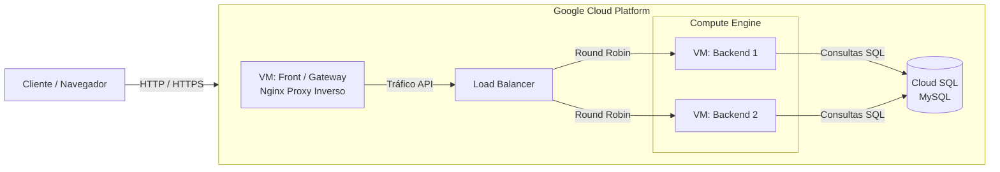
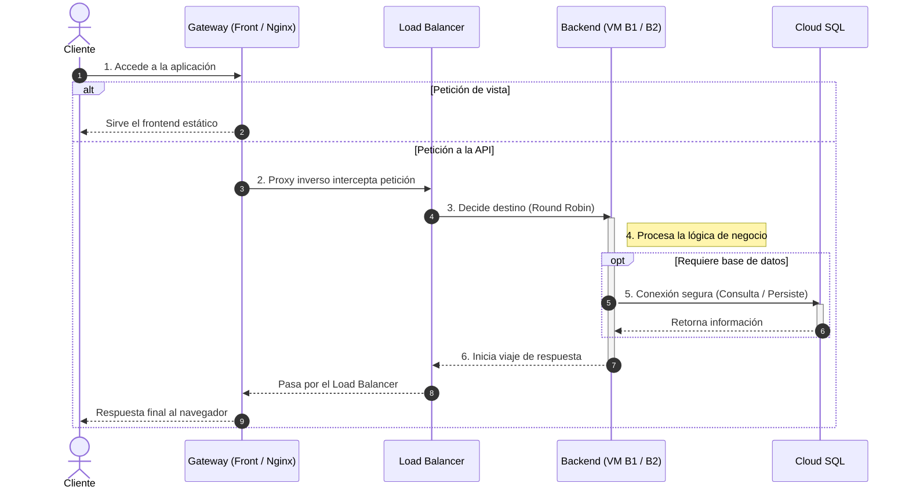

# Arquitectura de Infraestructura - Unidad 1 (Google Cloud)

## 1. Resumen

El proyecto de la Unidad 1 se encuentra desplegado sobre una infraestructura en la nube utilizando Google Cloud Platform (GCP). La arquitectura está diseñada para garantizar alta disponibilidad y escalabilidad horizontal en la capa de la aplicación.

El flujo divide las responsabilidades en distintas capas: un servidor que actúa como Gateway/Frontend, un balanceador de carga, múltiples instancias de backend alojadas en Máquinas Virtuales (Compute Engine) y una base de datos centralizada mediante el servicio gestionado Cloud SQL.

## 2. Vista de despliegue

## 3. Descripción de Componentes

La infraestructura se compone de los siguientes recursos dentro de GCP:

**Front / Gateway (Compute Engine):** Máquina virtual que sirve los archivos estáticos de la interfaz de usuario. Además, funciona como proxy inverso (Nginx), interceptando las peticiones del cliente hacia la API y redirigiéndolas hacia la red interna.

**Load Balancer:** Componente encargado de recibir el tráfico de la API proveniente del Gateway y distribuirlo equitativamente entre las distintas instancias de backend disponibles.

**Instancias de Backend (Compute Engine):** Dos máquinas virtuales independientes (B1 y B2) que ejecutan la lógica de negocio de la aplicación. Trabajan en paralelo para soportar una mayor carga de usuarios y proporcionar redundancia (si una falla, la otra sigue operando de forma transparente).

**Base de Datos (Cloud SQL para MySQL):** Servicio de base de datos relacional totalmente gestionado por Google Cloud. Al utilizar Cloud SQL en lugar de una VM tradicional, se delega a GCP la administración del sistema operativo, los parches de seguridad y los respaldos automatizados, garantizando que ambos backends se conecten a un endpoint altamente disponible.

## 4. Flujo de una petición

